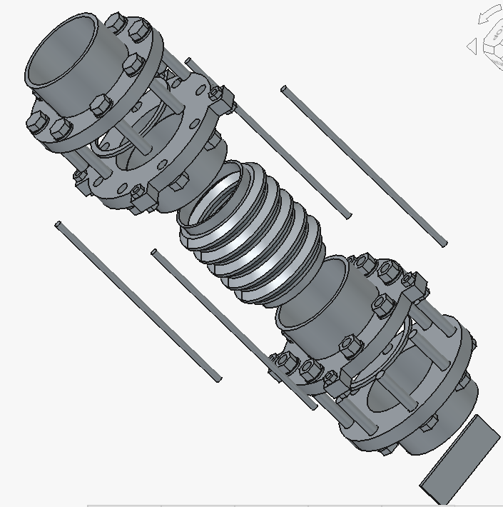
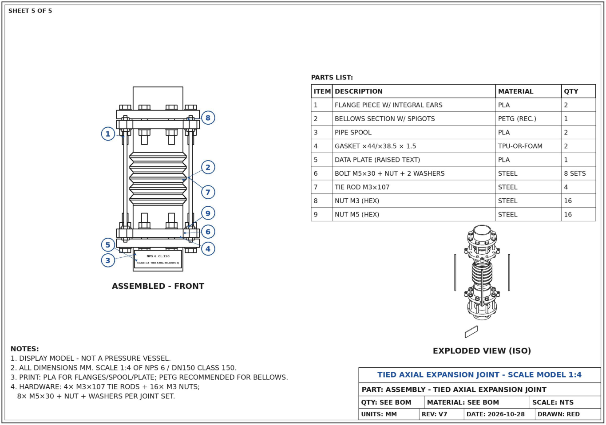

# OpenClaw + FreeCAD

A project to have [OpenClaw](https://github.com/openclaw/openclaw) model a part in FreeCAD. The agent used the **GLM-5.3** model (z.ai, via OpenRouter) and drove FreeCAD 1.1.4 headless through its Python API — no GUI clicking.

The part is a **tied axial bellows expansion joint**: parametric bodies, an App::Link assembly, and a five-sheet drawing package. The human reviewed renders and PDFs; the agent did the modeling.

## Files

- [assembly_v7.FCStd](assembly_v7.FCStd) — FreeCAD assembly (v7).
- [expansion_joint_v7_drawings.pdf](expansion_joint_v7_drawings.pdf) — five-sheet drawing package.

Also in the repo: `freecad/` (server and drawing scripts), `systemd/`, and `skills/`.

## More

- [OVERVIEW.md](OVERVIEW.md) — architecture, version history, and lessons from the trial (Oct 12 – Nov 1, 2026).
- [INSTALL.txt](INSTALL.txt) — how to stand up the FreeCAD TCP server, systemd unit, and agent skills on an OpenClaw host.

MIT licensed. See [LICENSE](LICENSE).
